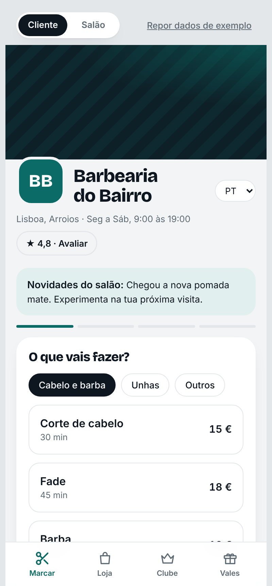
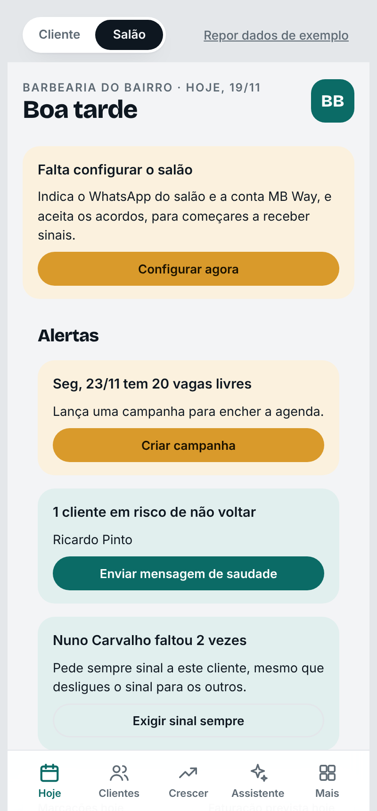
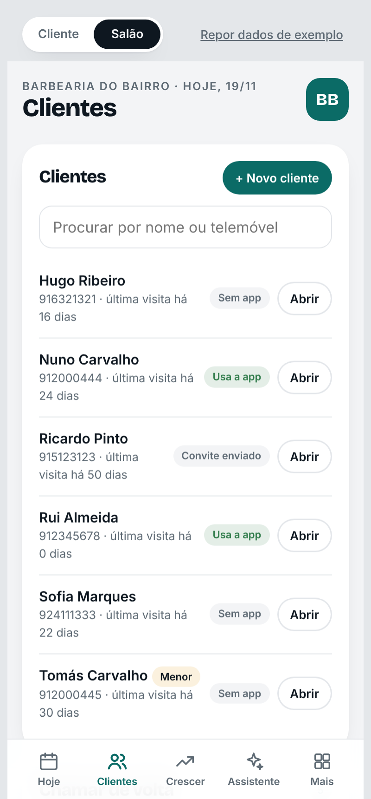
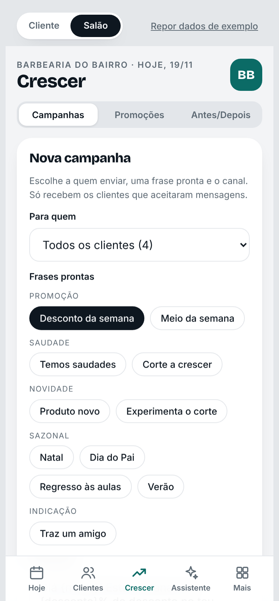
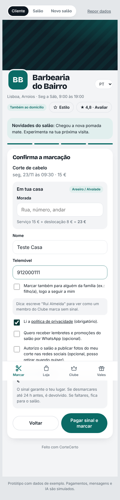

# CorteCerto

**A booking and growth app for barbers, hair salons and nail studios in Portugal.** This repository holds the clickable product prototype, built to validate the idea with salon owners before the production build.

> Status: the production MVP lives in [`app/`](app/README.md) and is deployed at https://cortecerto-app.amadiz-sabino.workers.dev. The clickable prototype in [`prototype/`](prototype/index.html) is kept for reference; its payments, messages and AI are simulated.

  
  
  
  
  

## The problem

Small salons in Portugal still take most bookings by phone, Instagram DM and WhatsApp. That means no-shows with no deposit, clients who drift away unnoticed, and no simple way to bring them back. The international tools are built for larger chains, charge per staff member, and don't support MB Way or Portuguese-language flows.

## What the prototype shows

**Client side**
- Booking in a few taps: service, barber, day and time, then an MB Way deposit to the salon's own number
- AI cut recommender and a try-on preview from a selfie, with a catalogue of named cuts
- Share a try-on to Instagram or TikTok so friends can vote on it
- Try-on for beard styles and eyebrow shapes, not just hair and nails
- Home visits: choose "at the salon" or "at my home", pick a zone and see the travel fee set by the salon
- A walk-in queue: join from a QR poster, see how many people are ahead and get a WhatsApp near your turn
- Salon shop, loyalty club, prepaid packs and gift vouchers
- The salon's rules shown before paying the deposit, and a one-time health form for waxing and colouring
- Clients can switch the app to another theme they like
- Opt-in consents for messages, photos and minors (through the guardian), never pre-ticked

**Salon side**
- Today: the agenda, no-show risk per booking, AI notes and alerts (clients at risk of leaving, empty slots)
- Clients: a lightweight CRM with history, products bought, family members, birthdays and referral codes
- Grow: campaigns with ready-made phrases by segment and channel, promotions, and before/after posts with client consent
- Today: a live walk-in queue, missed calls answered with a WhatsApp booking link, and a one-tap "book the next visit" after each visit
- Assistant: a chat assistant that answers prices, availability and cancellations
- Team: register each professional with their agreement (commission, chair rental or salary), services, own prices and working days, plus a monthly payout summary
- Club and packs: invite clients by WhatsApp or register desk payments, and sell prepaid packs at prices the salon sets
- Invoicing: connects to the salon's own certified invoicing program (Vendus, InvoiceXpress, Moloni, TOConline) and issues the invoice when a visit is marked done
- QR posters with the salon's logo and theme, for bookings, the queue and Google reviews
- Look: 32 themes by salon type (barbershop, hair salon, nail studio, waxing) for the client page and the owner's panel
- Sign-up: guided onboarding with salon type, services, style, WhatsApp, deposit, home visits, plan and checkout

## Product decisions

- **Mobile-first web app (PWA)** instead of native apps. No app store fees or review delays, and one link a salon can put in its Instagram bio.
- **Deposits go straight to the salon's MB Way.** The platform never holds client money, which keeps compliance simple.
- **WhatsApp click-to-send** for reminders and campaigns at zero cost, with a path to the paid API later.
- **Privacy by default.** Every consent is opt-in and logged, and photos of clients need explicit permission before they're shared.
- **The salon sets every price.** The app may suggest prices for services, travel fees and packs, but the salon always decides.
- **Near-zero running cost.** Invoicing uses the salon's own program, and messages start as free WhatsApp links.
- **Differentiators in the core plan, extras as add-ons.** Try-on and AI are what make the product stand out, and the shop and vouchers are upsells.

## Try it

Open [`prototype/index.html`](prototype/index.html) in any browser, or enable GitHub Pages on this repository. Use the switch at the top to move between the **Cliente** and **Salão** views, and **Repor dados** to reset the sample data.

The prototype is a single HTML file with vanilla JavaScript and no build step. It inlines [qrcode-generator](https://github.com/kazuhikoarase/qrcode-generator) (MIT) to draw real, scannable QR codes.

## Roadmap

1. Core build: salon sign-up and onboarding, services, booking, agenda, consents, deposits and reminders
2. Free pilot with a small group of salons in Lisbon
3. Paid launch, then AI assistant, campaigns and try-on
4. Shop, club and vouchers

## About

Product concept, research, requirements and UX by Francisco Sabino, built with [Claude Code](https://claude.com/claude-code).
